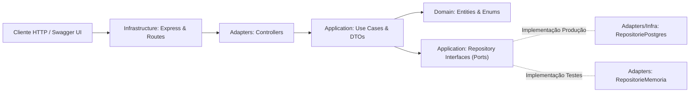

# QuimiPort — Sistema de Gestão de Cargas Químicas Portuárias

> **Tech Challenge — Pós Tech FIAP | Full Stack Development — Fase 2**

---

## 1. Descrição do Projeto

O **QuimiPort** é uma aplicação backend RESTful voltada para o controle operacional, segurança e rastreabilidade de **produtos químicos** e **cargas químicas** em ambiente portuário.

A movimentação portuária de substâncias perigosas exige rigoroso controle sobre classificações de risco (padrão ONU), quantidades movimentadas, validade da documentação técnica obrigatória (como FISPQ), responsáveis técnicos, níveis de acesso e transições de estado das cargas. O **QuimiPort** centraliza essas informações e protege as invariantes de segurança diretamente no modelo de domínio, impedindo que cargas irregulares, bloqueadas ou sem documentação validada avancem para movimentação ou embarque.

---

## 2. Objetivo da Fase 2

Evoluir a proposta técnica e arquitetural concebida na **Fase 1** ([`docs/DesignDocument.md`](./docs/DesignDocument.md)) para uma **aplicação funcional completa** ([`docs/DesignDocument_Fase2.md`](./docs/DesignDocument_Fase2.md)), entregando:

- **API REST** construída com Node.js, Express e TypeScript;
- **Regras de Negócio e Máquina de Estados** implementadas e protegidas nas camadas de Domínio e Aplicação;
- **Persistência de dados relacional** em **PostgreSQL** (com suporte a repositórios em memória para testes isolados);
- **Suíte de Testes Automatizados** com **Jest** cobrindo os 12 cenários obrigatórios do desafio;
- **Documentação interativa da API** com **Swagger UI (OpenAPI 3.0)** em `/api-docs`;
- **Containerização** da aplicação e do banco de dados com **Docker** e **Docker Compose**;
- **Pipeline de CI/CD** automatizado com **GitHub Actions**.

---

## 3. Arquitetura Adotada

O projeto adota **Clean Architecture** combinada com princípios de **Domain-Driven Design (DDD)**, garantindo que o núcleo de negócio (`domain` e `application`) permaneça independente de frameworks externos, banco de dados ou protocolo HTTP.



### Divisão das Camadas:
1. **`src/domain` (Domínio):** Contém as entidades de negócio (`ProdutoQuimico`, `CargaQuimica`, `DocumentoCarga`, `Historico`, `Usuario`, `AreaArmazenamento`), interfaces de agregados e enums (`enumStatusCarga`, `enumClasseRisco`, `enumNivelAcesso`). Não possui nenhuma dependência externa.
2. **`src/application` (Aplicação):** Contém os Casos de Uso (`Use Cases`), objetos de transferência de dados (`DTO`) e os contratos/interfaces dos repositórios (`Ports/Repositories`).
3. **`src/adapters` (Adaptadores de Interface):** Contém os `Controllers` HTTP (`ProdutoController`, `CargaController`) e implementações de repositórios (`RepositorieMemoria`).
4. **`src/infrastructure` (Infraestrutura):** Contém a configuração do servidor Express (`app.ts`), rotas (`ProdutoRoutes`, `CargaRoutes`), especificação do Swagger UI (`swagger.ts`) e o pool de conexão com inicialização automática de tabelas no PostgreSQL (`connection.ts`).
5. **`src/Composition` (Composition Root):** O arquivo `container.ts` realiza a **Injeção de Dependências**, conectando os repositórios PostgreSQL aos Casos de Uso e injetando-os nos Controllers.

> 📄 **Documentação Arquitetural Detalhada:**
> - [Documento de Design — Fase 1 (Modelagem Original)](./docs/DesignDocument.md)
> - [Documento de Design — Fase 2 (Implementação Atualizada)](./docs/DesignDocument_Fase2.md)

---

## 4. Tecnologias Utilizadas

| Tecnologia | Versão / Pacote | Finalidade no Projeto |
|---|---|---|
| **Node.js** | v20+ / v22 | Ambiente de execução JavaScript/TypeScript no servidor |
| **TypeScript** | `^5.9.3` | Tipagem estática, interfaces e segurança em tempo de compilação |
| **Express** | `^5.2.1` | Framework HTTP para construção das rotas, middlewares e API REST |
| **PostgreSQL (`pg`)** | `^8.20.0` | Driver de conexão e persistência em banco de dados relacional PostgreSQL 16 |
| **Swagger UI Express** | `^5.0.1` | Interface interativa para documentação e teste dos endpoints (OpenAPI 3.0) |
| **Jest & ts-jest** | `^29.7.0` | Framework de testes automatizados unitários e de integração de regras de negócio |
| **Docker & Docker Compose** | `postgres:16-alpine` / `node:22-alpine` | Containerização e orquestração da API e do banco de dados |
| **GitHub Actions** | `ci.yml` | Integração Contínua (verificação de compilação e execução automática dos testes) |

---

## 5. Estrutura de Pastas

```text
Projeto_Pós_Tech_FIAP_FULLSTACK_Fase 1/
│
├── .github/
│   └── workflows/
│       └── ci.yml                          # Pipeline de CI/CD (GitHub Actions)
│
├── docs/
│   ├── DesignDocument.md                   # Documento de Design original (Fase 1)
│   ├── DesignDocument_Fase2.md             # Documento de Design atualizado (Fase 2)
│   └── POSTECH - FSDT - Tech Challenge - Fase 2.pdf
│
├── src/
│   ├── domain/                             # Camada de Domínio (Entidades, Interfaces e Enums)
│   │   ├── Entities/
│   │   │   ├── Aggregate Interfaces/
│   │   │   ├── Domain Interfaces/
│   │   │   ├── AreaArmazenamento.ts
│   │   │   ├── CargaQuimica.ts
│   │   │   ├── DocumentoCarga.ts
│   │   │   ├── Historico.ts
│   │   │   ├── Inspecao.ts
│   │   │   ├── ProdutoQuimico.ts
│   │   │   └── Usuario.ts
│   │   └── enums/
│   │       ├── enumClasseRisco.ts
│   │       ├── enumNivelAcesso.ts
│   │       ├── enumResultadoInspecao.ts
│   │       └── enumStatusCarga.ts
│   │
│   ├── application/                        # Camada de Aplicação (Use Cases, DTOs e Ports)
│   │   ├── DTO/
│   │   │   ├── cargaDTO.ts
│   │   │   └── produtoDTO.ts
│   │   ├── Ports/
│   │   │   └── Repositories/
│   │   │       ├── RepositorieCarga.ts
│   │   │       ├── RepositorieProduto.ts
│   │   │       └── RepositoriePostgres.ts
│   │   └── Use Cases/
│   │       ├── AtualizarProduto.ts
│   │       ├── AtualizarStatusCarga.ts
│   │       ├── BloquearCarga.ts
│   │       ├── BuscarProdutoPorID.ts
│   │       ├── CadastrarProduto.ts
│   │       ├── CancelarCarga.ts
│   │       ├── GetCargaID.ts
│   │       ├── InativarProduto.ts
│   │       ├── LiberarCarga.ts
│   │       ├── ListarCargas.ts
│   │       ├── ListarProdutos.ts
│   │       ├── RegistrarCarga.ts
│   │       ├── ValidarDocumentacao.ts
│   │       └── ValidarNivelAcesso.ts
│   │
│   ├── adapters/                           # Camada de Adaptadores (Controllers e Repositório em Memória)
│   │   ├── controllers/
│   │   │   ├── CargaController.ts
│   │   │   └── ProdutoController.ts
│   │   └── repositories/
│   │       └── RepositorieMemoria.ts
│   │
│   ├── infrastructure/                     # Camada de Infraestrutura (HTTP, Banco e Swagger)
│   │   ├── database/
│   │   │   └── connection.ts
│   │   └── http/
│   │       ├── app/
│   │       │   └── app.ts
│   │       ├── routes/
│   │       │   ├── CargaRoutes.ts
│   │       │   └── ProdutoRoutes.ts
│   │       └── swagger.ts
│   │
│   ├── Composition/                        # Injeção de Dependências
│   │   └── container.ts
│   │
│   └── index.ts                            # Ponto de entrada do servidor (Porta 35500)
│
├── tests/
│   └── quimiport.spec.ts                   # Suíte com os 12 cenários obrigatórios de teste (Jest)
│
├── .dockerignore
├── .env
├── Dockerfile
├── docker-compose.yml
├── jest.config.cjs
├── package.json
├── README.md
└── tsconfig.json
```

---

## 6. Pré-requisitos

Antes de executar o projeto, certifique-se de ter instalado em sua máquina:

- **[Node.js](https://nodejs.org/)** (versão 20 ou superior) e **npm**;
- **[Docker](https://www.docker.com/)** e **Docker Compose** (para execução do banco PostgreSQL ou da stack containerizada completa);
- **[Git](https://git-scm.com/)**.

---

## 7. Configuração de Variáveis de Ambiente

A aplicação utiliza variáveis de ambiente para configurar a conexão com o banco de dados PostgreSQL em `src/infrastructure/database/connection.ts`.

Crie ou verifique o arquivo **`.env`** na raiz do projeto com os seguintes valores:

```env
PORT=35500
DB_HOST=localhost
DB_PORT=5433
DB_USER=postgres
DB_PASSWORD=postgrespassword
DB_NAME=quimiport
```

| Variável | Descrição | Valor Padrão (Local / Docker) |
|---|---|---|
| `PORT` | Porta HTTP onde a API Express é iniciada | `35500` |
| `DB_HOST` | Endereço do servidor PostgreSQL (`localhost` fora do container, `db` no Compose) | `localhost` |
| `DB_PORT` | Porta do PostgreSQL mapeada na máquina host | `5433` (no host) / `5432` (interno no container) |
| `DB_USER` | Usuário do banco de dados PostgreSQL | `postgres` |
| `DB_PASSWORD` | Senha do banco de dados PostgreSQL | `postgrespassword` |
| `DB_NAME` | Nome do database utilizado pela aplicação | `quimiport` |

---

## 8. Instruções para Executar Localmente

1. **Instale as dependências do projeto:**
   ```bash
   npm install
   ```

2. **Suba o container do banco de dados PostgreSQL:**
   ```bash
   docker compose up -d db
   ```
   *(Ou via `docker run --name quimiport-postgres -e POSTGRES_USER=postgres -e POSTGRES_PASSWORD=postgrespassword -e POSTGRES_DB=quimiport -p 5433:5432 -d postgres:16-alpine`)*

3. **Inicie o servidor em modo de desenvolvimento:**
   ```bash
   npm run dev
   ```
   Ao iniciar, o sistema executa automaticamente a função `inicializarBanco()`, criando as tabelas `produtos_quimicos` e `cargas_quimicas` caso ainda não existam, e disponibiliza:
   - **API Base URL:** `http://localhost:35500`
   - **Swagger UI (Documentação Interativa):** `http://localhost:35500/api-docs`

---

## 9. Instruções para Executar com Docker

Para subir **toda a solução (Banco de Dados PostgreSQL + API QuimiPort)** de forma integrada com um único comando utilizando o `docker-compose.yml`:

1. **Construir e iniciar os containers:**
   ```bash
   docker compose up --build
   ```
   *(O serviço `api` aguarda automaticamente o `healthcheck` do serviço `db` responder como saudável antes de iniciar).*

2. **Para executar em segundo plano (detached mode):**
   ```bash
   docker compose up -d --build
   ```

3. **Para parar e remover os containers:**
   ```bash
   docker compose down
   ```

---

## 10. Instruções para Executar os Testes

A suíte de testes automatizados foi construída com **Jest** e **ts-jest** no arquivo [`tests/quimiport.spec.ts`](./tests/quimiport.spec.ts).

Para rodar todos os testes:

```bash
npm test
```

Para validar também a checagem de tipos do TypeScript sem gerar arquivos de build:

```bash
npx tsc --noEmit
```

### Cenários Cobertos pelos Testes Automatizados (12 Cenários Obrigatórios):
1. **Cenário 1:** Cadastrar produto químico válido com sucesso (`statusAtivo = true`).
2. **Cenário 2:** Impedir cadastro de produto químico sem nome ou sem classe de risco.
3. **Cenário 3:** Inativar produto químico e impedir seu vínculo em nova carga.
4. **Cenário 4:** Registrar carga química válida com status inicial `REGISTRADA`.
5. **Cenário 5:** Impedir registro de carga química com `quantidade <= 0`.
6. **Cenário 6:** Impedir registro de carga associada a produto químico inexistente ou inativo.
7. **Cenário 7:** Avançar carga química por transições de status válidas (`REGISTRADA -> EM_ANALISE -> EM_INSPECAO`).
8. **Cenário 8:** Impedir transição de status inválida (ex.: `REGISTRADA -> FINALIZADA`).
9. **Cenário 9:** Bloquear carga química com motivo obrigatório e impedir avanço indevido (`BLOQUEADA -> EM_MOVIMENTO`).
10. **Cenário 10:** Liberar carga química em inspeção quando documentação está validada e produto ativo.
11. **Cenário 11:** Impedir liberação de carga química sem documentação obrigatória validada.
12. **Cenário 12:** Cancelar carga química com motivo e impedir alterações posteriores em cargas `CANCELADAS` ou `FINALIZADAS`.

---

## 11. Exemplos de Requisições da API

Você pode testar todos os endpoints diretamente pelo navegador através do **Swagger UI**:
👉 **`http://localhost:35500/api-docs`**

### Resumo das Rotas Disponíveis

| Método | Rota | Descrição |
|---|---|---|
| `POST` | `/produtos-quimicos` | Cadastra um novo produto químico (`statusAtivo = true`) |
| `GET` | `/produtos-quimicos` | Lista todos os produtos químicos cadastrados |
| `GET` | `/produtos-quimicos/:id` | Busca um produto químico específico por ID |
| `PUT` | `/produtos-quimicos/:id` | Atualiza os dados cadastrais de um produto químico |
| `PATCH` | `/produtos-quimicos/:id/inativar` | Inativa logicamente um produto químico (`statusAtivo = false`) |
| `POST` | `/cargas-quimicas` | Registra uma nova carga química vinculada a um produto ativo |
| `GET` | `/cargas-quimicas` | Lista todas as cargas químicas registradas |
| `GET` | `/cargas-quimicas/:id` | Busca uma carga química específica por ID |
| `PATCH` | `/cargas-quimicas/:id/status` | Atualiza o status da carga conforme a máquina de estados |
| `PATCH` | `/cargas-quimicas/:id/bloquear` | Bloqueia uma carga química registrando o motivo no histórico |
| `PATCH` | `/cargas-quimicas/:id/liberar` | Libera uma carga química após validação documental |
| `PATCH` | `/cargas-quimicas/:id/cancelar` | Cancela uma carga química registrando justificativa no histórico |
| `PATCH` | `/cargas-quimicas/:idCarga/documentos/:idDocumento/validar` | Valida um documento obrigatório associado à carga |

### Exemplos de Payloads (JSON)

#### 1. Cadastrar Produto Químico (`POST /produtos-quimicos`)
```json
{
  "nome": "Ácido Sulfúrico",
  "descricao": "Ácido forte corrosivo de uso industrial",
  "codigoONU": "ONU-1830",
  "classeRisco": "CLASSE_8 - Corrossivos",
  "grupoCompatibilidade": "Grupo B"
}
```

#### 2. Registrar Carga Química (`POST /cargas-quimicas`)
```json
{
  "codigoCarga": "CARGA-SANTOS-001",
  "produtoId": "COLE_AQUI_O_ID_DO_PRODUTO",
  "responsavelTecnicoId": "user-1",
  "origemCarga": "Porto de Rotterdam",
  "destinoCarga": "Porto de Santos",
  "quantidade": 150,
  "unidadeMedida": "Toneladas"
}
```

#### 3. Avançar Status da Carga (`PATCH /cargas-quimicas/:id/status`)
```json
{
  "novoStatus": "EM_ANALISE"
}
```

#### 4. Bloquear Carga Química (`PATCH /cargas-quimicas/:id/bloquear`)
```json
{
  "motivo": "Vazamento identificado na válvula do container durante inspeção"
}
```

#### 5. Cancelar Carga Química (`PATCH /cargas-quimicas/:id/cancelar`)
```json
{
  "motivo": "Cancelamento operacional solicitado pelo cliente"
}
```

---

## 12. Explicação Resumida das Regras de Negócio Implementadas

### Regras de Produto Químico:
- **Obrigatoriedade de Dados:** Nenhum produto pode ser cadastrado sem `nome` ou sem uma `classeRisco` pertencente ao `enumClasseRisco`.
- **Ciclo de Vida e Inativação Lógica:** Todo produto nasce com `statusAtivo = true`. Ao ser inativado via `PATCH /produtos-quimicos/:id/inativar`, ele permanece no banco para preservar o histórico, mas o sistema bloqueia qualquer tentativa de criar novas cargas vinculadas a ele.

### Regras de Carga Química e Máquina de Estados:
- **Validação na Entrada:** Uma carga exige `quantidade > 0` e um produto químico existente e ativo. Toda carga nasce com status `REGISTRADA`.
- **Fluxo Controlado de Status:**
  - `REGISTRADA` -> `EM_ANALISE` -> `EM_INSPECAO` -> `LIBERADA` -> `EM_MOVIMENTO` -> `FINALIZADA`.
  - Cargas em inspeção podem ir para `BLOQUEADA` (exige motivo obrigatório) e retornar para `EM_INSPECAO` após regularização.
  - Uma carga `BLOQUEADA` nunca pode ir diretamente para `EM_MOVIMENTO` ou `FINALIZADA`.
- **Liberação Segura:** O caso de uso `LiberarCarga` exige que a carga esteja `EM_INSPECAO`, que o produto químico continue ativo e que possua documentação obrigatória associada e validada (`validado = true`).
- **Estados Terminais (`FINALIZADA` e `CANCELADA`):** Uma vez `FINALIZADA` ou `CANCELADA`, a carga não permite novas alterações de status nem liberação.
- **Rastreabilidade:** Todas as mudanças de status, bloqueios e cancelamentos adicionam um registro em `AtualizacaoHistorico` contendo data/hora, status anterior, novo status e justificativa.

---

## 13. Explicação da Pipeline de CI/CD

O projeto conta com integração contínua configurada no GitHub Actions através do arquivo [`.github/workflows/ci.yml`](./.github/workflows/ci.yml).

Sempre que um `push` ou `pull_request` é realizado nas branches `main` ou `master`, o workflow **`CI - QuimiPort API`** executa automaticamente em um runner Ubuntu (`ubuntu-latest`):

1. **Checkout do código (`actions/checkout@v4`):** Baixa a versão atual do repositório;
2. **Setup do Node.js 20 (`actions/setup-node@v4`):** Configura o ambiente Node.js com cache do `npm`;
3. **Instalação de dependências (`npm install`):** Instala todos os pacotes do projeto;
4. **Verificação de compilação e tipagem (`npx tsc --noEmit`):** Garante que não existem erros de TypeScript em nenhuma camada da arquitetura;
5. **Execução dos Testes Automatizados (`npm test`):** Executa os 12 cenários obrigatórios no Jest, garantindo que nenhuma regra de negócio foi quebrada antes de aceitar a alteração.
