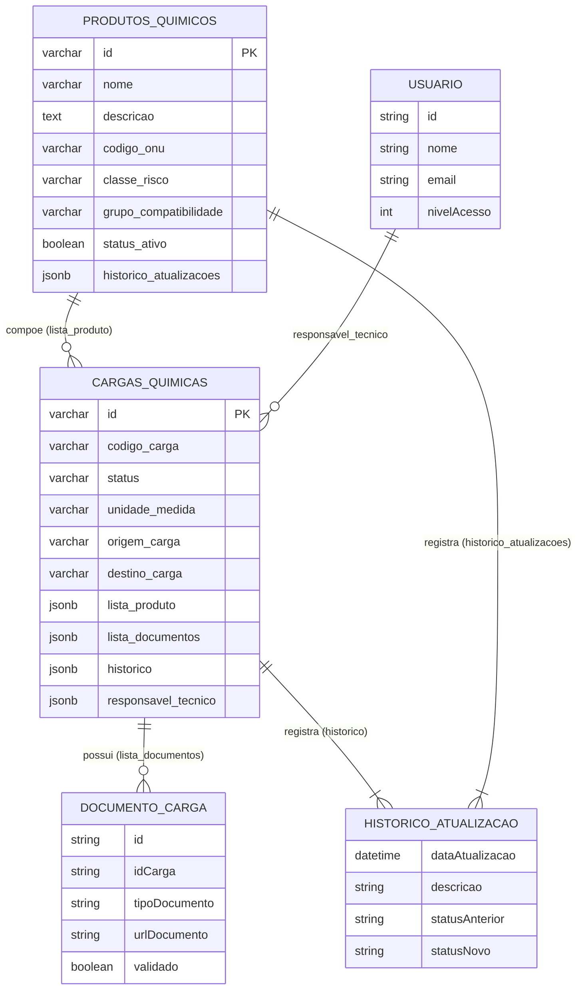
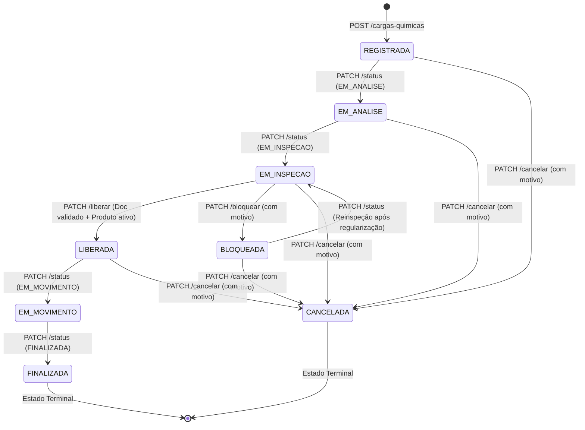
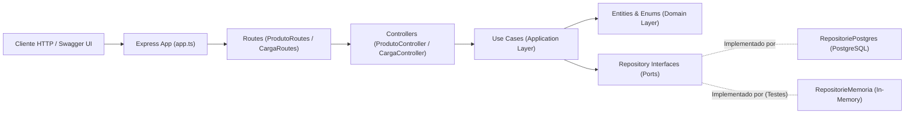

# QuimiPort — Documento de Design de Software (Fase 2)

> **Tech Challenge — Pós Tech FIAP | Full Stack Development | Fase 2**
>
> Evolução técnica e arquitetural do sistema de gestão de cargas químicas portuárias: da modelagem de domínio (Fase 1) para uma API REST funcional com Clean Architecture, PostgreSQL, Testes Automatizados (Jest), Swagger UI, Docker e CI/CD.

---

## 1. Objetivo e escopo

O **QuimiPort** é um sistema backend para organizar e controlar o fluxo operacional de produtos e cargas químicas em ambiente portuário, centralizando informações de produtos químicos, classificação de risco (ONU), cargas, documentação obrigatória, responsáveis técnicos, controle de acesso e rastreabilidade histórica de status.

Esta documentação atualiza o documento original da **Fase 1** (`DesignDocument.md`), refletindo todas as implementações concretas realizadas na **Fase 2**:

- Construção da **API REST** com Node.js, Express e TypeScript;
- Implementação das **Regras de Negócio e Máquina de Estados** na camada de Domínio e Aplicação;
- **Persistência de dados real** em banco relacional **PostgreSQL** (`pg`) + implementação em memória para testes rápidos;
- **Injeção de Dependências (Composition Root)** desacoplando casos de uso da infraestrutura;
- **Suíte de Testes Automatizados** com **Jest** cobrindo os 12 cenários obrigatórios de negócio;
- **Documentação interativa da API** utilizando **Swagger UI (OpenAPI 3.0)** em `/api-docs`;
- **Containerização** completa com `Dockerfile` e `docker-compose.yml`;
- **Pipeline de Integração Contínua (CI/CD)** com **GitHub Actions**.

### 1.1 Escopo implementado na Fase 2

O sistema permite operacionalmente via API REST:

- Cadastrar produtos químicos (`POST /produtos-quimicos`);
- Listar todos os produtos químicos (`GET /produtos-quimicos`);
- Buscar produto químico por ID (`GET /produtos-quimicos/:id`);
- Atualizar dados de um produto químico com registro de histórico (`PUT /produtos-quimicos/:id`);
- Inativar logicamente um produto químico (`PATCH /produtos-quimicos/:id/inativar`);
- Registrar novas cargas químicas vinculadas a produtos ativos (`POST /cargas-quimicas`);
- Listar todas as cargas químicas (`GET /cargas-quimicas`);
- Buscar carga química por ID (`GET /cargas-quimicas/:id`);
- Avançar e controlar o status da carga respeitando a máquina de estados (`PATCH /cargas-quimicas/:id/status`);
- Bloquear cargas com motivo obrigatório (`PATCH /cargas-quimicas/:id/bloquear`);
- Validar documentação obrigatória da carga (`PATCH /cargas-quimicas/:idCarga/documentos/:idDocumento/validar`);
- Liberar cargas mediante validação documental e produto ativo (`PATCH /cargas-quimicas/:id/liberar`);
- Cancelar cargas com justificativa obrigatória (`PATCH /cargas-quimicas/:id/cancelar`).

---

## 2. Entendimento do domínio

### 2.1 Problema

A movimentação de produtos químicos exige controle rigoroso de informações como classificação de risco ONU, quantidade, documentação técnica, inspeção, nível de acesso dos operadores e responsabilidade técnica.

Quando esse controle é manual ou descentralizado, aumenta o risco operacional de liberar cargas com produtos inativos, sem documentação validada ou violando etapas de inspeção. O **QuimiPort** centraliza essas regras diretamente no domínio e nos casos de uso da aplicação.

### 2.2 Objetivo da solução

Garantir que uma carga química só avance no fluxo portuário quando todas as invariantes de segurança, ativo de produto, documentação validada e permissão de acesso forem atendidas, mantendo rastreabilidade completa em histórico.

### 2.3 Perfis de Usuário e Níveis de Acesso (`enumNivelAcesso`)

Na Fase 2, o controle de permissão foi implementado através do enum numérico `enumNivelAcesso` e validado pelo caso de uso `ValidarNivelAcesso`:

| Nível (`enumNivelAcesso`) | Valor Numérico | Responsabilidade no Sistema |
|---|---|---|
| `OPERADOR_PORTUARIO` | `0` | Consultar produtos e cargas |
| `ANALISTA_DOCUMENTACAO` | `1` | Validar documentação obrigatória associada às cargas |
| `RESPONSAVEL_TECNICO` | `2` | Registrar cargas, atualizar status, bloquear, liberar e validar documentos |
| `GESTOR_OPERACIONAL` | `3` | Cadastrar, atualizar e inativar produtos químicos; cancelar cargas |
| `ADMINISTRADOR` | `4` | Permissão total em todas as operações do sistema |

---

## 3. Linguagem ubíqua

A linguagem utilizada no código-fonte, nos DTOs, nos endpoints HTTP e nos testes mantém fidelidade aos conceitos do negócio portuário:

| Termo | Significado no Domínio e no Código |
|---|---|
| **Produto Químico (`ProdutoQuimico`)** | Substância química cadastrada com código ONU, classe de risco e status ativo/inativo |
| **Classe de Risco (`enumClasseRisco`)** | Classificação internacional de risco (Classes 1 a 9: Explosivos, Gases, Líquidos Inflamáveis, Corrosivos, etc.) |
| **Carga Química (`CargaQuimica`)** | Aggregate Root que representa o lote/carga submetido ao fluxo operacional portuário |
| **Status da Carga (`enumStatusCarga`)** | Estado atual da carga no fluxo (`REGISTRADA`, `EM_ANALISE`, `EM_INSPECAO`, `LIBERADA`, `BLOQUEADA`, `EM_MOVIMENTO`, `FINALIZADA`, `CANCELADA`) |
| **Documento da Carga (`DocumentoCarga`)** | Documento obrigatório (ex: FISPQ) vinculado à carga que precisa ser validado antes da liberação |
| **Histórico (`Historico` / `AtualizacaoHistorico`)** | Registro cronológico de todas as transições de status e motivos de alteração em produtos e cargas |
| **Inativação Lógica** | Desativação de um produto químico (`statusAtivo = false`) sem excluí-lo do banco, preservando o histórico e impedindo novas cargas |

---

## 4. Modelagem com Domain-Driven Design (DDD)

### 4.1 Entidades e Interfaces de Domínio Implementadas

#### `ProdutoQuimico` (`src/domain/Entities/ProdutoQuimico.ts`)

Representa o produto químico homologado no porto. Gera automaticamente seu identificador único via `crypto.randomUUID()` e registra sua criação no histórico.

```text
id: string (UUID)
nome: string
descricao: string
codigoONU: string
classeRisco: enumClasseRisco
grupoCompatibilidade: string
statusAtivo: boolean (nasce sempre true)
historicoAtualizacoes: IHistorico
```

#### `CargaQuimica` (`src/domain/Entities/CargaQuimica.ts`)

É a entidade central do domínio e principal **Aggregate Root**. Protege a criação exigindo um produto químico ativo (`_produtoQuimico.statusAtivo !== false`) e inicia obrigatoriamente com status `REGISTRADA`.

```text
id: string
codigoCarga: string
status: enumStatusCarga
listaProduto: IProdutoQuimico[]
unidadeMedida: string
origemCarga: string
destinoCarga: string
histórico: IHistorico
listaDocumentosCarga: IDocumentoCarga[]
responsavelTecnico: IUsuario
espacoArmazenamento: EspacoArmazenamento
```

#### `DocumentoCarga` (`src/domain/Entities/DocumentoCarga.ts`)

Representa um documento técnico exigido para a liberação da carga.

```text
id: string
idCarga: string
tipoDocumento: string
urlDocumento: string
validado: boolean
```

#### `Historico` e `AtualizacaoHistorico` (`src/domain/Entities/Historico.ts`)

Mantém a trilha de auditoria de todas as mudanças de estado da carga ou do produto.

```text
dataAtualizacao: Date
descricao: string (motivo/justificativa)
statusAnterior: enumStatusCarga
statusNovo: enumStatusCarga
```

#### `Usuario` (`src/domain/Entities/Usuario.ts`)

Representa o agente que executa a operação nos casos de uso, validado por `ValidarNivelAcesso`.

```text
id: string
nome: string
email: string
senha: string
nivelAcesso: enumNivelAcesso
```

---

## 5. Modelagem de Dados e Persistência (PostgreSQL)

Na Fase 2, a persistência foi implementada utilizando o pacote `pg` (`Pool` de conexões em `src/infrastructure/database/connection.ts`) com criação automática do schema (`inicializarBanco()`) e suporte a tipos `JSONB` do PostgreSQL para armazenar os agregados da `CargaQuimica` e `ProdutoQuimico` sem perda de fidelidade ao modelo rico de domínio.

### 5.1 Diagrama de Entidade-Relacionamento (Conceitual + Físico)



### 5.2 Estratégia de Repositórios (Portas e Adaptadores)

Seguindo a **Clean Architecture**, os casos de uso dependem apenas das interfaces (Portas):
- `IProdutoRepository` (`src/application/Ports/Repositories/RepositorieProduto.ts`)
- `ICargaRepository` (`src/application/Ports/Repositories/RepositorieCarga.ts`)

E o projeto conta com **duas implementações intercambiáveis**:
1. **Repositório PostgreSQL (`RepositoriePostgres.ts`)**: Utilizado pela API em execução (`src/Composition/container.ts`), executando queries parametrizadas (`$1, $2...`) contra SQL Injection.
2. **Repositório em Memória (`RepositorieMemoria.ts`)**: Utilizado pela suíte de testes automatizados (`tests/quimiport.spec.ts`), permitindo execução rápida e isolada no CI/CD.

---

## 6. Regras de Negócio Implementadas

Todas as regras abaixo foram implementadas nas entidades e casos de uso e são validadas automaticamente pelos testes:

| ID | Regra de Negócio | Onde é Garantida |
|---|---|---|
| **RN-01** | Um produto químico não pode ser cadastrado sem `nome` | `CadastrarProduto.ts` |
| **RN-02** | Um produto químico não pode ser cadastrado sem `classeRisco` válida (`enumClasseRisco`) | `CadastrarProduto.ts` |
| **RN-03** | Todo produto químico recém-cadastrado nasce com `statusAtivo = true` | `ProdutoQuimico.ts` |
| **RN-04** | Um produto químico inativo (`statusAtivo = false`) não pode ser vinculado a uma nova carga | `RegistrarCarga.ts` e `CargaQuimica.ts` |
| **RN-05** | Uma carga química não pode ser registrada com `quantidade <= 0` | `RegistrarCarga.ts` |
| **RN-06** | Toda carga recém-registrada nasce obrigatoriamente com status `REGISTRADA` | `CargaQuimica.ts` |
| **RN-07** | Uma carga não pode ser liberada (`LIBERADA`) sem documentação obrigatória associada e validada (`validado = true`) | `LiberarCarga.ts` |
| **RN-08** | Uma carga `BLOQUEADA` não pode avançar diretamente para movimentação (`EM_MOVIMENTO`) nem ser finalizada | `AtualizarStatusCarga.ts` |
| **RN-09** | Uma carga `CANCELADA` é estado terminal e não pode ser liberada nem sofrer novas alterações | `LiberarCarga.ts` e `AtualizarStatusCarga.ts` |
| **RN-10** | Uma carga `FINALIZADA` é estado terminal e não pode retornar a estados operacionais ou ser cancelada | `AtualizarStatusCarga.ts` e `CancelarCarga.ts` |
| **RN-11** | O bloqueio de uma carga exige `motivo` obrigatório e registra a ocorrência no histórico | `BloquearCarga.ts` |
| **RN-12** | O cancelamento de uma carga exige `motivo` obrigatório e registra a ocorrência no histórico | `CancelarCarga.ts` |
| **RN-13** | Cada operação exige nível mínimo de acesso do usuário (`enumNivelAcesso`) | `ValidarNivelAcesso.ts` |

---

## 7. Máquina de Estados e Fluxo da Carga (`enumStatusCarga`)

### 7.1 Estados Implementados (`src/domain/enums/enumStatusCarga.ts`)

```typescript
export enum enumStatusCarga {
      EMPTY = '',
      REGISTRADA = 'REGISTRADA',
      EM_ANALISE = 'EM_ANALISE',
      EM_INSPECAO = 'EM_INSPECAO',
      LIBERADA = 'LIBERADA',
      BLOQUEADA = 'BLOQUEADA',
      CANCELADA = 'CANCELADA',
      EM_MOVIMENTO = 'EM_MOVIMENTO',
      FINALIZADA = 'FINALIZADA'
}
```

### 7.2 Diagrama de Transição de Estados Implementado



---

## 8. Casos de Uso e Endpoints REST Implementados

### 8.1 Mapeamento de Casos de Uso (`src/application/Use Cases/`)

| Caso de Uso | Classe | Nível Mínimo Exigido | Endpoint HTTP Correspondente |
|---|---|---|---|
| **UC-01** | `CadastrarProduto` | `GESTOR_OPERACIONAL` | `POST /produtos-quimicos` |
| **UC-02** | `ListarProdutos` | `OPERADOR_PORTUARIO` | `GET /produtos-quimicos` |
| **UC-03** | `BuscarProdutoPorID` | `OPERADOR_PORTUARIO` | `GET /produtos-quimicos/:id` |
| **UC-04** | `AtualizarProduto` | `GESTOR_OPERACIONAL` | `PUT /produtos-quimicos/:id` |
| **UC-05** | `InativarProduto` | `GESTOR_OPERACIONAL` | `PATCH /produtos-quimicos/:id/inativar` |
| **UC-06** | `RegistrarCarga` | `RESPONSAVEL_TECNICO` | `POST /cargas-quimicas` |
| **UC-07** | `ListarCargas` | `OPERADOR_PORTUARIO` | `GET /cargas-quimicas` |
| **UC-08** | `GetCargaID` | `OPERADOR_PORTUARIO` | `GET /cargas-quimicas/:id` |
| **UC-09** | `AtualizarStatusCarga` | `RESPONSAVEL_TECNICO` | `PATCH /cargas-quimicas/:id/status` |
| **UC-10** | `BloquearCarga` | `RESPONSAVEL_TECNICO` | `PATCH /cargas-quimicas/:id/bloquear` |
| **UC-11** | `LiberarCarga` | `RESPONSAVEL_TECNICO` | `PATCH /cargas-quimicas/:id/liberar` |
| **UC-12** | `CancelarCarga` | `GESTOR_OPERACIONAL` | `PATCH /cargas-quimicas/:id/cancelar` |
| **UC-13** | `ValidarDocumentacao` | `ANALISTA_DOCUMENTACAO` | `PATCH /cargas-quimicas/:idCarga/documentos/:idDocumento/validar` |

### 8.2 Documentação Interativa com Swagger UI

A API conta com especificação **OpenAPI 3.0** (`src/infrastructure/http/swagger.ts`) servida via `swagger-ui-express` na rota:
- **`http://localhost:35500/api-docs`**

Pela interface do Swagger UI é possível visualizar todos os contratos de entrada (Request Body), exemplos de payload, códigos de status HTTP (`200`, `201`, `400`, `404`) e executar requisições diretamente pelo navegador ("Try it out").

---

## 9. Arquitetura Implementada (Clean Architecture)

### 9.1 Fluxo de Execução e Injeção de Dependências



O arquivo `src/Composition/container.ts` atua como o **Composition Root** da aplicação: ele instancia os repositórios PostgreSQL, injeta-os nos Casos de Uso e injeta os Casos de Uso nos Controllers, mantendo a camada de domínio e de aplicação 100% desacopladas do banco de dados e do framework HTTP.

---

## 10. Qualidade e Testes Automatizados (Jest)

Na Fase 2, os testes foram implementados com **Jest** e **ts-jest** no arquivo `tests/quimiport.spec.ts`, validando os **12 cenários obrigatórios** exigidos pelo desafio:

1. **Cenário 1:** Cadastrar produto químico válido com sucesso (`statusAtivo = true`).
2. **Cenário 2:** Impedir cadastro de produto químico sem nome ou sem classe de risco.
3. **Cenário 3:** Inativar produto químico e impedir seu vínculo em nova carga.
4. **Cenário 4:** Registrar carga química válida com status inicial `REGISTRADA`.
5. **Cenário 5:** Impedir registro de carga química com `quantidade <= 0`.
6. **Cenário 6:** Impedir registro de carga associada a produto químico inexistente ou inativo.
7. **Cenário 7:** Avançar carga química por transições de status válidas (`REGISTRADA -> EM_ANALISE -> EM_INSPECAO`).
8. **Cenário 8:** Impedir transição de status inválida (ex.: `REGISTRADA -> FINALIZADA`).
9. **Cenário 9:** Bloquear carga química com motivo obrigatório e impedir avanço indevido (`BLOQUEADA -> EM_MOVIMENTO`).
10. **Cenário 10:** Liberar carga química em inspeção quando documentação está validada e produto ativo.
11. **Cenário 11:** Impedir liberação de carga química sem documentação obrigatória validada.
12. **Cenário 12:** Cancelar carga química com motivo e impedir alterações posteriores em cargas `CANCELADAS` ou `FINALIZADAS`.

Comando para execução:
```bash
npm test
```

---

## 11. Containerização (Docker) e CI/CD (GitHub Actions)

### 11.1 Docker e Docker Compose
- **`Dockerfile`**: Empacota a aplicação Node.js 20 Alpine, instala dependências e expõe a API na porta `35500`.
- **`docker-compose.yml`**: Orquestra dois serviços em rede:
  - `db` (`postgres:15-alpine`) com healthcheck (`pg_isready`) e volume persistente `pgdata`.
  - `api` (aplicação QuimiPort) configurada com `depends_on: condition: service_healthy`.

### 11.2 Pipeline CI/CD (`.github/workflows/ci.yml`)
Executado automaticamente a cada `push` ou `pull_request` nas branches `main` e `master`:
1. Faz checkout do código (`actions/checkout@v4`);
2. Configura o ambiente Node.js 20 com cache de dependências (`actions/setup-node@v4`);
3. Instala dependências (`npm install`);
4. Valida a tipagem estática do projeto (`npx tsc --noEmit`);
5. Executa os 12 testes automatizados do Jest (`npm test`).

---

## 12. Estrutura Real de Pastas do Projeto (Fase 2)

```text
Projeto_Pós_Tech_FIAP_FULLSTACK_Fase 1/
│
├── .github/
│   └── workflows/
│       └── ci.yml                          # Pipeline de CI/CD (GitHub Actions)
│
├── docs/
│   ├── DesignDocument.md                   # Documento de Design original (Fase 1)
│   ├── DesignDocument_Fase2.md             # Documento de Design atualizado (Fase 2)
│   └── POSTECH - FSDT - Tech Challenge - Fase 2.pdf
│
├── src/
│   ├── domain/                             # Camada de Domínio (Regras puras e Entidades)
│   │   ├── Entities/
│   │   │   ├── Aggregate Interfaces/
│   │   │   │   ├── IDocumentoCarga.ts
│   │   │   │   ├── IHistorico.ts
│   │   │   │   └── IInspecao.ts
│   │   │   ├── Domain Interfaces/
│   │   │   │   ├── IAreaArmazenamento.ts
│   │   │   │   ├── ICargaQuimica.ts
│   │   │   │   ├── IProdutoQuimico.ts
│   │   │   │   └── IUsuario.ts
│   │   │   ├── AreaArmazenamento.ts
│   │   │   ├── CargaQuimica.ts
│   │   │   ├── DocumentoCarga.ts
│   │   │   ├── Historico.ts
│   │   │   ├── Inspecao.ts
│   │   │   ├── ProdutoQuimico.ts
│   │   │   └── Usuario.ts
│   │   └── enums/
│   │       ├── enumClasseRisco.ts
│   │       ├── enumNivelAcesso.ts
│   │       ├── enumResultadoInspecao.ts
│   │       └── enumStatusCarga.ts
│   │
│   ├── application/                        # Camada de Aplicação (Casos de Uso, DTOs e Portas)
│   │   ├── DTO/
│   │   │   ├── cargaDTO.ts
│   │   │   └── produtoDTO.ts
│   │   ├── Ports/
│   │   │   └── Repositories/
│   │   │       ├── RepositorieCarga.ts
│   │   │       ├── RepositorieProduto.ts
│   │   │       └── RepositoriePostgres.ts
│   │   └── Use Cases/
│   │       ├── AtualizarProduto.ts
│   │       ├── AtualizarStatusCarga.ts
│   │       ├── BloquearCarga.ts
│   │       ├── BuscarProdutoPorID.ts
│   │       ├── CadastrarProduto.ts
│   │       ├── CancelarCarga.ts
│   │       ├── GetCargaID.ts
│   │       ├── InativarProduto.ts
│   │       ├── LiberarCarga.ts
│   │       ├── ListarCargas.ts
│   │       ├── ListarProdutos.ts
│   │       ├── RegistrarCarga.ts
│   │       ├── ValidarDocumentacao.ts
│   │       └── ValidarNivelAcesso.ts
│   │
│   ├── adapters/                           # Camada de Adaptadores (Controllers e Repositórios)
│   │   ├── controllers/
│   │   │   ├── CargaController.ts
│   │   │   └── ProdutoController.ts
│   │   └── repositories/
│   │       └── RepositorieMemoria.ts
│   │
│   ├── infrastructure/                     # Camada de Infraestrutura (Express, Swagger, PostgreSQL)
│   │   ├── database/
│   │   │   └── connection.ts
│   │   └── http/
│   │       ├── app/
│   │       │   └── app.ts
│   │       ├── routes/
│   │       │   ├── CargaRoutes.ts
│   │       │   └── ProdutoRoutes.ts
│   │       └── swagger.ts
│   │
│   ├── Composition/                        # Injeção de Dependências (Composition Root)
│   │   └── container.ts
│   │
│   └── index.ts                            # Ponto de entrada do servidor (Porta 35500)
│
├── tests/
│   └── quimiport.spec.ts                   # 12 Cenários obrigatórios de teste (Jest)
│
├── .dockerignore
├── .env
├── Dockerfile
├── docker-compose.yml
├── jest.config.cjs
├── package.json
├── README.md
└── tsconfig.json
```

---

## 13. Conclusão

Com a evolução concluída na **Fase 2**, o **QuimiPort** deixou de ser apenas um modelo conceitual e tornou-se uma aplicação backend completa, testada, documentada e containerizada, preservando rigorosamente a separação de responsabilidades da **Clean Architecture** e os princípios de **Domain-Driven Design (DDD)** estabelecidos na Fase 1.
